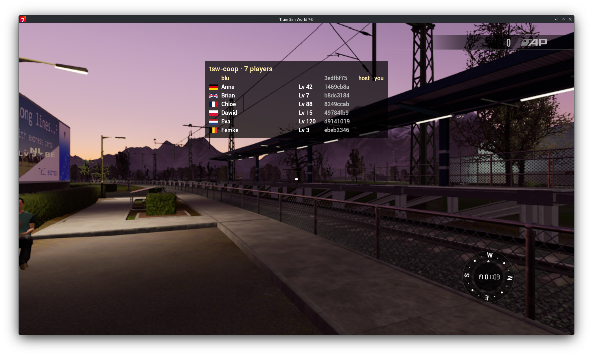

# Hosted session with a crowd, in game (2026-10-18)

First runs of a session hosted inside the game (`host = 7441`) with seven
`crowd` bots (`server/crates/tsw-coop-client/examples/crowd.rs`) walking,
running, jumping, crouching and sitting around the host in the Training
Centre. Driven entirely by code: `devapi.sh ttc`, `devapi.sh key TAB 6`,
`crowd <invite> - 7 <seconds>`, screenshots of the game window.

## What works (seen in game)

- **Hosting:** the game's own client joins its server over loopback; the
  Fritz!Box maps the port (UPnP) and the invite carries the public and LAN
  addresses. Bots dialling every address at once reach it through the LAN
  address and through the router's public address (hairpin NAT works).
- **Countries from addresses:** `geoip = auto` downloaded
  `GeoLite2-Country.mmdb` (3.4 MB) in 0.5 s through urlmon; every local
  player (loopback, LAN) was flagged with the country of the router's
  public address (DE). `geoip = claims` (testing) showed the bots' claimed
  DE/GB/FR/PL/NL/BE.
- **Bodies:** seven bodies spawn in ~30 ms together, follow walk/run/jump/
  crouch/seated, and are removed 10 s after a player goes silent.
- **Name tags:** "Name · Lv N · CC" above each body, readable (not
  mirrored), turned toward the camera.
- **TAB scoreboard:** runtime UMG on `HUDWidgetsCanvasPanel`; flag images
  from `Win64/tswcoop/flags/*.png` via `ImportFileAsTexture2D`, names,
  levels, id prefixes, "host · you".
- **Main menu badge:** `Win64/tswcoop/logo.png` on the menu's
  `TSWLogoImage_C` canvas; top right covered the profile header, bottom
  centre is free.
- **Server log:** joins (name, country, level, mod, route, peer), bans
  (`warn join refused: banned … by=player id`), chat lines, leaves with the
  reason (`Closed`, `Timeout` after 30 s of a frozen client).

Screenshots (2050×1238, the game window):

| | |
| :--- | :--- |
|  | Main menu with the tsw-coop badge at the bottom centre |
|  | Bots walking, crouching and sitting; name tags with level and country |
|  | TAB scoreboard in `geoip = claims` mode; Gustav is banned and missing |
|  | TAB scoreboard after the level fix (own row Lv 1), second crowd after a forced GC |

## What broke, and the fixes

| Symptom | Cause | Fix |
| :--- | :--- | :--- |
| Game gone ~1 s after start, before UE4SS loaded | the DLL had gained a static `winhttp.dll` import | download with `URLDownloadToFileW`, urlmon loaded on demand |
| Host never joined its own session: "hello must be the first message" | the client sent queued snapshots before answering the relay's challenge | nothing but `hello` until the welcome (`conn.rs`, regression test `data_queued_before_the_welcome_waits_for_it`) |
| Own level unknown | `GetDriverLevel` counts from 0 (menu "LV 1" = 0) | shown level = raw + 1 |
| Crash (access violation reading 0x280 in `PlayAnimation`) as the bots left | animation assets cached as raw pointers; nothing roots them, GC freed one | `Held` (object-array slot checked) for cached assets, meshes, the toast icon, the cab view, the frozen pawn; assets reloaded when freed |

The crash was found from the minidump (`Saved/Crashes/UE4CC-*/UE4Minidump.dmp`;
Proton adds stream type 0xFFF0, which the Python `minidump` package rejects
unless unknown types are mapped to unused) and `llvm-symbolizer
--relative-address --inlining` on our PDB: the stack held
`Avatars::animate → NativeFn::call_void` (avatar.rs, `PlayAnimation`).

**Rule:** an `Object` kept across frames is a `Held`; `Object::is_live`
reads the object itself and is only for objects the game just returned.

## Second run: public session with a password (2026-10-18)

Free Roam on Frankfurt S-Bahn (`tswup play FrankfurtSBahn free`), `public = on`,
`password`, `master` = the NAS master, later `nat_relay = n0`. Bots from `crowd` with the
new switches (`CROWD_PACKS`, `CROWD_MOD`/`CROWD_BUILD`, `CROWD_TRANSPORT`, `CROWD_ADDRS`,
`CROWD_ROGUE`, `CROWD_FRONT`).

- **Crash at start, fixed:** the game ended right after the mod's first two log lines,
  before UE4SS loaded, with no crash report. The mod asked Steam (`GetLaunchCommandLine`,
  and the new DLC licence check) during the DLL load, before the game had initialised
  Steamworks. Both now run from the tick.
- **Seen working:** listing on the master with a short code, `/status` over LAN and the
  public address (hairpin), refusals for missing DLC, banned, full, wrong password, older
  mod and other build, each with its reason in the scoreboard's refused section; runtime
  kick (the waiting 9th bot took the seat); QUIC through the router's UDP mapping; a guest
  with no address joining through n0's relay; the web view page, the spectator page, the
  Pages site against the NAS master with the live map.
- **Rogue guest:** 1528 messages over the rate limit, 60 out-of-bounds positions and 59
  oversized messages were dropped; the game was unaffected. Two gaps fixed: every dropped
  message was a log line (now one count per player per 10 s), and chat lines had no length
  cap (now 500 characters).
- **Screenshots without the window:** the window-capture tool returns whatever window covers
  the game. `devapi.sh shot` asks the game itself (`shot showui`, the PNG lands in the
  Proton prefix's `Saved/Screenshots/WindowsNoEditor`), UI included, whatever is on top.
- **Keys reach the unfocused game:** under Proton the game read keys typed into another
  window (photo mode on O and the task panel on T opened while the maintainer typed
  elsewhere).

## Still open

- The crouch pose is the male bench-sit idle (the only crouch animation,
  `CH_F_hiker_Crouched`, is for the female skeleton): a crouching bot looks
  seated in the air. *Since then:* the pak index has a male one,
  `Male/Anims/Crouch/CH_M_hiker1`, now played first (bench sit as the
  fallback); untested in game.
- The game build is not read yet (`build=0`), so a build mismatch is never
  reported. *Since then:* read with `GetBuildNumber` (`src/game_info.rs`),
  untested in game.
