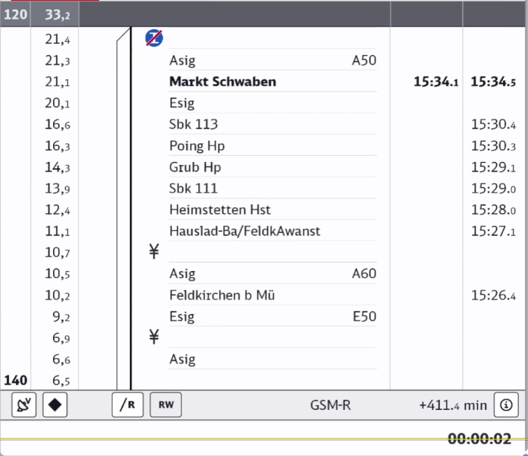
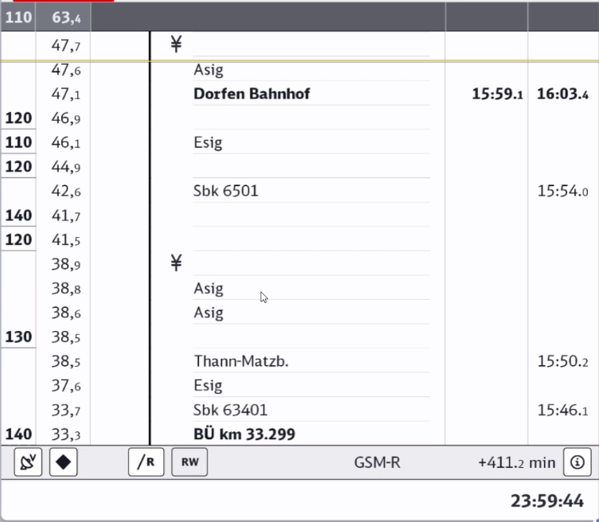
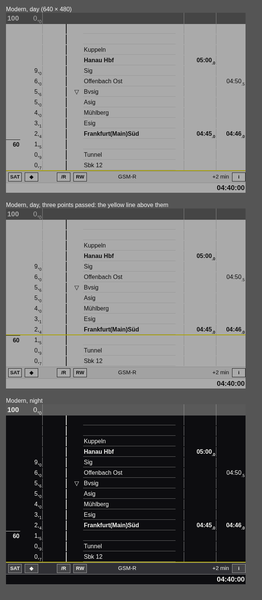

# Alternative EBuLa view (2026-10-24)

The owner sent two screenshots of a different EBuLa style and asked for it as an
**alternate view mode**: a new option next to the existing look (which follows
[ebula-real-screens.md](ebula-real-screens.md)), not a replacement.

| Markt Schwaben | Dorfen |
| :---: | :---: |
|  |  |

Route in both: Munich–Mühldorf (Markt Schwaben, Poing, Dorfen).

## What the view shows

- **Header**: the current speed limit and the current km, e.g. `110 | 63,4`.
- **Columns**, left to right:
  - speed limit, bold, boxed where it changes;
  - km with one decimal;
  - a track-graphic column (the line, with branches at stations);
  - a symbol column (e.g. `¥`, a blue crossed Z);
  - the text column. Signals are written with their names right-aligned (`Asig A50`,
    `Esig E50`, `Sbk 6501`), stations in bold (`Dorfen Bahnhof`, `Markt Schwaben`), level
    crossings as `BÜ km 33.299`.
- **Times** with a tenths digit: arrival and departure (`15:59.1` / `16:03.4`); a pass time
  sits in the departure column (`15:54.0`).
- **Current position**: a yellow line across the rows.
- **Soft-key bar** at the bottom: icon buttons (antenna/satellite, ◆, `/R`, `RW`), `GSM-R`,
  the delay (`+411.2 min`) and an (i) button.
- **Status line** below it with the clock (`23:59:44`, `00:00:02`).

## In tsw-ebula (d92101a)

`ebula.style = classic | modern` chooses the look, switched at runtime by the style hotkey
or the `ebula.style` command (a physical cab key is coming, from the survey in
[ebula-cab-screens.md](ebula-cab-screens.md)). The page data is the same; `src/modern.rs` draws it:

- the page's train row becomes the header (speed and km at the train);
- the body has 14 rows in seven columns (speed 38, km 60, track 74, symbol 34, text 270,
  arrival 86, departure 78 px at the 640 px design width), ruled after km, text and
  arrival as in the photos;
- a rule over the speed where it changes, bold stops with bold times;
- a yellow 2 px line under the lowest point ahead of the train; the points passed (kept
  by `scroll`) stay below it;
- the softkey bar (SAT, ◆, /R, RW, radio, delay, i) and a clock line;
- day and night palettes scaled to a cab screen's light like the classic ones.

The HTML preview the unit test writes (`EBULA_PREVIEW_MODERN`): day, three points passed, night.

Not taken from the photos: the signal number right-aligned in the text column (the game gives
no signal ids, so names like "Sbk 12" stay as one text), the blue crossed Z and ¥ symbols
(no source yet), the small red tab at the top left.
