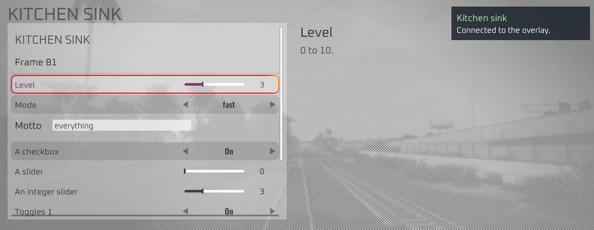
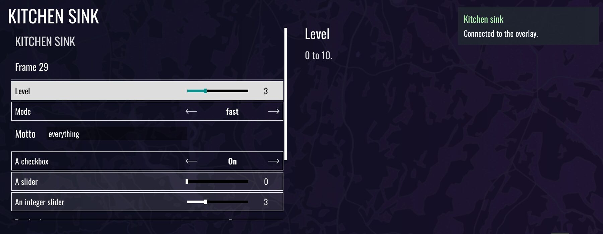

# Other editions: Train Sim World 5 (2026-10-18)

TSW 5 (Steam app 2967990, build 21051341, UE 4.26, only the Training Centre installed) was checked
in two steps. First a static comparison of the exe with TSW 7's, without starting the game. Then a
run with the same DLLs as on TSW 7, unchanged. **Everything loads and works.** The only
differences were cosmetic or a hard-coded "7", and those are fixed now.

## Static comparison

- All six engine patterns resolve exactly once: `GUObjectArray`, `FName::ToString`,
  `FName::FName`, `GMalloc`, `GEngine` and `UGameEngine::Tick`. ProcessEvent is vtable slot 67
  and the tick is slot 85.
- The HUD screen-stack offsets and the struct sizes match TSW 7, and so do all 188 `/Script`
  paths the plugins use. Every `/Game` asset they create exists.
- Missing: `DialogButton_C.UseCustomColors`, which tsw_ui already treats as optional.
- The game ships `steam_api64.dll` from Steamworks 1.47 (TSW 7: 1.52). That version lacks the
  per-interface accessors such as `SteamAPI_SteamFriends_v017`.

## In game

Deployed with `TSW_DIR=".../Train Sim World 5" scripts/deploy.sh` (tsw-sdk), launched through
Steam:

- The loader starts all plugins (tsw, tsw_ui, jump, coop, kitchen sink, debug socket). The
  kitchen sink's self-test passes 68 of 68.
- The engine scan finds the addresses the static check predicted. The tick is hooked after
  1.1 s, and the intro skip passes the splash screens in 0.6 s.
- tsw_ui works: the menu elements resolve, and pages, the console, toasts, notices and dialogs
  all show. The settings rows are the game's own, so they look like TSW 5's.
- coop starts, and finds Steam since the fallback below.

The Training Centre is the only content installed, so nothing was tested in a world: jump,
driving, and a coop session.

| TSW 7 | TSW 5 |
| :---: | :---: |
|  |  |

## What differed, and the fixes

| Difference | Fix |
| :--- | :--- |
| Menu look: TSW 7 has dark text on a light panel, TSW 5 white text straight on a dark background. The text blocks of the rows are white in both editions (TSW 7 tints them dark from further up the tree), so reading the widgets cannot tell the looks apart. | tsw_ui picks a palette by edition (`palette.rs`): the light look from TSW 7 on, the dark one before. |
| Which edition is running | `tsw_sdk_host::edition`: from Steam's `SteamAppId` when the id is a known one, else from the `Train Sim World N` folder on the way to the exe (or to a plugin DLL, for code that runs outside the game). |
| Crash reports were read from `My Games/TrainSimWorld7` | They are now read from the edition's own folder. |
| Steamworks 1.47 has no `SteamAPI_SteamFriends_v017` or `SteamAPI_SteamApps_v008` | When those are missing, the interfaces come from `SteamInternal_FindOrCreateUserInterface(SteamAPI_GetHSteamUser(), "SteamFriends017")` and `"STEAMAPPS_INTERFACE_VERSION008"`, the version strings the TSW 5 exe itself uses. |
| coop: join links started TSW 7, and the hello claimed "Train Sim World 7" | A link starts the edition the mod is installed in, and the hello names the running edition. |

## Installing on another edition

- Proton has to load the native `dwmapi.dll`. On TSW 7 that is done in the launch options
  (`WINEDLLOVERRIDES="dwmapi=n,b" %command%`). For TSW 5 it was set in the game's Proton prefix
  instead: `"dwmapi"="native,builtin"` under `[Software\\Wine\\DllOverrides]` in
  `compatdata/2967990/pfx/user.reg`, written while the game was not running. That is what RaiPal
  does too.
- `tswcoop://` links have one handler per Windows user. Every time the game starts, coop
  registers itself as that handler, so the edition started last handles the links.

## Open

- In a world on TSW 5: jump, coop sessions, ghosts. This needs a route installed.
- TSW 4 and 6 were not checked. Their app ids are not in `edition.rs` yet; the folder name still
  identifies them. They get the dark look, which is unverified for them.
